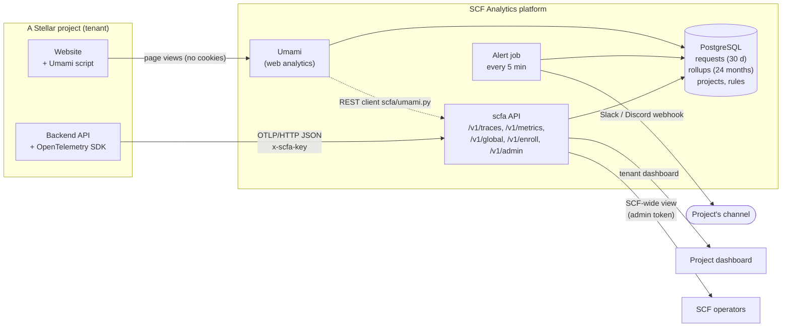
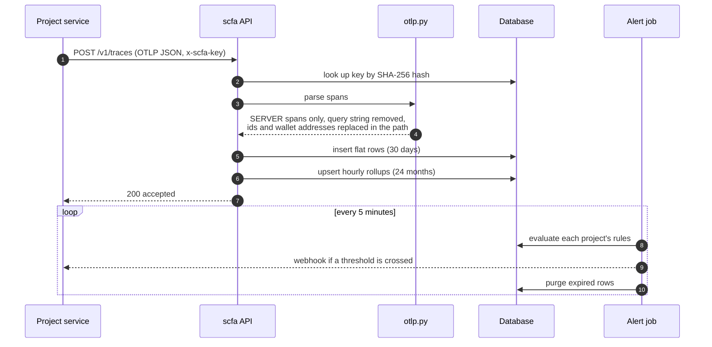
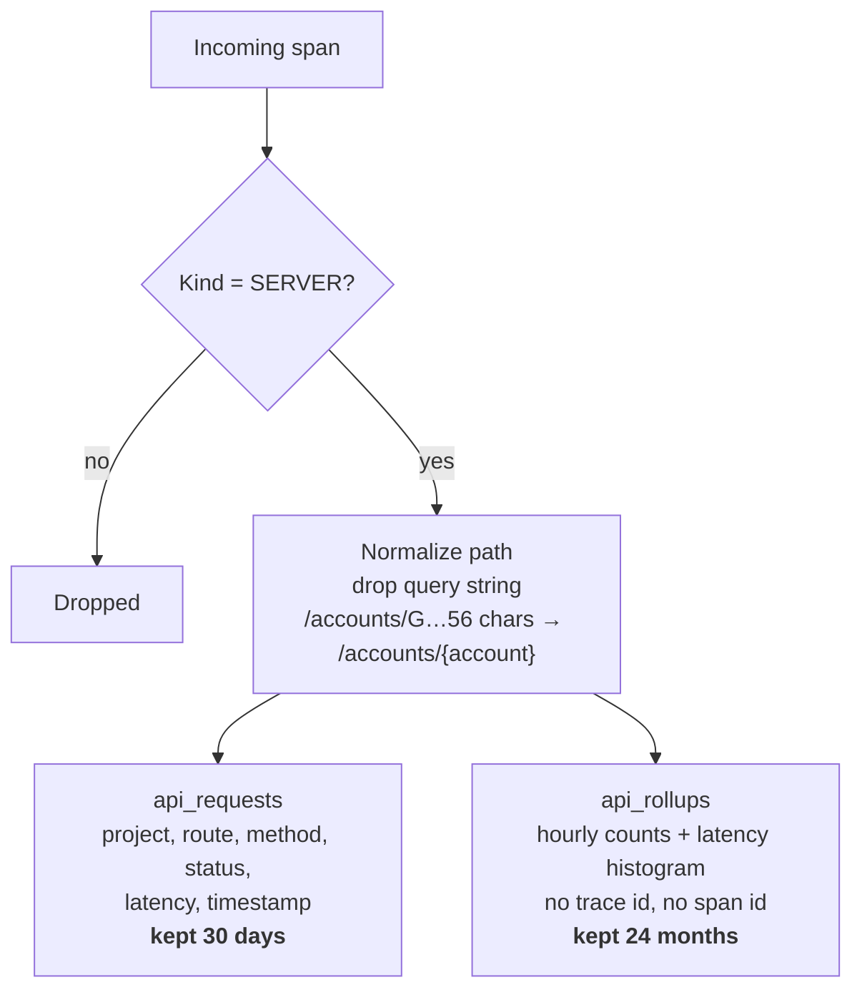
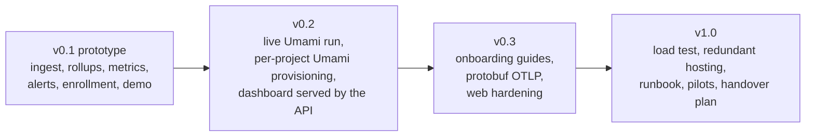

# SCF Analytics

[](https://github.com/kuidsh/scf-analytics/actions/workflows/tests.yml)


-orange)

**Privacy-first web and API analytics for Stellar ecosystem projects, run as one shared, multi-tenant service by the Stellar Community Fund (SCF).**

This repository is a working prototype and draft proposal for the SCF RFP Track request
*"Web and API Analytics for Stellar Ecosystem Projects"*
([handbook](https://stellar.gitbook.io/scf-handbook/scf-awards/build-award/rfp-track#current-open-rfps)).

> **Status: prototype, not deployed.** 17 automated tests pass. Nothing runs in the cloud, no money is spent, and the repository touches no mainnet, wallets or keys. All numbers in the demo dashboard are generated example data. The honest, requirement-by-requirement status is in [docs/RFP-COVERAGE.md](docs/RFP-COVERAGE.md).

## Contents

[What it does](#what-it-does) · [Architecture](#architecture) · [Request lifecycle](#request-lifecycle) · [Data and privacy](#data-and-privacy) · [Metrics](#metrics) · [API reference](#api-reference) · [Quick start](#quick-start) · [RFP coverage](#rfp-coverage) · [Proposal summary](#proposal-summary) · [Roadmap](#roadmap) · [Repository layout](#repository-layout) · [Licence](#licence)

## What it does

| For | You get |
|---|---|
| **A Stellar project** | A private dashboard: how many API requests, how many failed, how fast, per route and per Stellar protocol (SEP-10, SEP-12, SEP-24, SEP-31, Soroban RPC, Horizon); a reliability target (SLO) with an error budget; website visitors from Umami; alerts to Slack or Discord; CSV export. |
| **SCF operators** | One ecosystem-wide view (per-project totals only, no route detail); self-service enrollment for projects; remove a project and erase its data; rotate or revoke any project's key. |
| **Everyone** | No cookies, no IP addresses, no user agents, no query strings, no wallet addresses in stored paths. Open source, Apache-2.0. |

Two data sources, one place:

- **Web analytics**: self-hosted [Umami](https://github.com/umami-software/umami) (MIT, used unmodified) on PostgreSQL. Page views, unique visitors, referrers, session duration, bounce rate, country, device and browser.
- **API analytics** (this repo): a project points its OpenTelemetry exporter at `POST /v1/traces`. Server spans become request volume, status-code classes and p50/p95/p99 latency per normalized route.

## Architecture



The same Python handler runs as a local server, in Docker, or as an AWS Lambda behind an HTTP API (`infra/template.yaml`). PostgreSQL is used in production, SQLite in tests.

## Request lifecycle



## Data and privacy



| Stored | Never stored |
|---|---|
| project id, normalized route, method, status code, latency, timestamp | IP addresses, user agents, query strings, request or response bodies, headers, user or wallet identifiers, trace ids, span ids |
| project keys as SHA-256 hashes only | project keys in clear text (shown once at creation) |

Every database query is filtered by `project_id` (tenant isolation). Erasing a project is one operator call that deletes its rows, rollups and rules. See [docs/PRIVACY-GDPR.md](docs/PRIVACY-GDPR.md) (not legal advice).

## Metrics

| Metric | Definition |
|---|---|
| Failed rate | requests with status 500-599 ÷ all requests |
| p50 / p95 / p99 | nearest-rank percentile of latency. From the hourly rollups (windows over 30 days) it is the latency bucket's upper edge: accurate to the bucket, shown as `≈` in the dashboard |
| Protocol group | route prefix `/sep10`, `/sep12`, `/sep24`, `/sep31`, `/rpc` (Soroban RPC), `/horizon`, otherwise "Other" |
| SLO | default objective 99.5% of requests are not 5xx. **Error budget used** = failed rate ÷ (1 − target); above 100% the target is missed |
| Time ranges | 1 h, 6 h, 12 h, 1 d, 7 d, 30 d, 1 y (`?hours=1…8760`). Up to 30 days: exact raw rows. Beyond: hourly rollups |
| Alert rules | `error_rate`, `p95_ms`, `p99_ms`, and `requests_min` (fires when traffic drops below a threshold, which catches silent outages) |

## API reference

| Method and path | Auth header | Purpose |
|---|---|---|
| `POST /v1/traces` | `x-scfa-key` | Ingest OTLP/HTTP **JSON** traces (protobuf returns 415; bodies over 5 MB return 413) |
| `GET /v1/metrics?hours=24[&format=csv]` | `x-scfa-key` | The project's own metrics (JSON) or per-route CSV |
| `GET /v1/global?hours=24` | `x-scfa-admin` | SCF-wide view: per-project totals only |
| `POST /v1/enroll` | none | Self-service sign-up `{"id","name"}`; returns the key once. `ENROLLMENT=closed` disables it |
| `GET /v1/admin/projects` | `x-scfa-admin` | List projects |
| `POST /v1/admin/projects/<id>/rotate-key` | `x-scfa-admin` | New key; the old one stops working at once |
| `POST /v1/admin/projects/<id>/revoke-key` | `x-scfa-admin` | Key stops working, none issued |
| `DELETE /v1/admin/projects/<id>` | `x-scfa-admin` | Remove the project and erase all its data |
| `GET /healthz` | none | Liveness |

Point any OpenTelemetry SDK at it:

```bash
export OTEL_EXPORTER_OTLP_TRACES_ENDPOINT=http://localhost:8080/v1/traces
export OTEL_EXPORTER_OTLP_PROTOCOL=http/json
export OTEL_EXPORTER_OTLP_HEADERS=x-scfa-key=<project key>
```

## Quick start

Python 3.11+ only. There is no Node, npm or build step.

```bash
python -m pytest -q                  # 17 tests, offline, SQLite
python demo/build_demo.py            # writes demo/data.json (about 1.5 minutes)
python -m http.server 8000           # open http://localhost:8000/demo/
```

The demo page shows four made-up projects with traffic generated through the real pipeline: time ranges up to a year, website visitors, SLO bars, protocol breakdown, CSV download, the RFP coverage table, and the architecture and tests behind every number.

Run the API with a file database so project keys persist between shells (the default `:memory:` database cannot be shared):

```bash
export DATABASE_URL=local.sqlite ADMIN_TOKEN=dev
python -m scfa.app                                   # http://localhost:8080
curl -X POST localhost:8080/v1/enroll -d '{"id":"my-anchor","name":"My Anchor"}'   # prints the key once
curl "localhost:8080/v1/metrics?hours=6" -H "x-scfa-key: <KEY>"
curl localhost:8080/v1/global -H "x-scfa-admin: dev"
```

Full stack with PostgreSQL and Umami (needs Docker; local, costs nothing):

```bash
cd infra
PG_PASSWORD=localdev UMAMI_SECRET=localdev ADMIN_TOKEN=dev docker compose -p scfa-local up -d --build
# API on :8080, Umami on :3000 (login admin / umami). Stop and wipe: docker compose -p scfa-local down -v
```

## RFP coverage

Summary (full table with evidence in [docs/RFP-COVERAGE.md](docs/RFP-COVERAGE.md); the requirements are paraphrased from the handbook, so re-read the source before relying on this):

| Status | Requirements |
|---|---|
| **Built and tested** | tenant isolation and SCF global view · self-service enrollment · remove a project · key generation, rotation and revocation · OpenTelemetry ingest into PostgreSQL · path normalization · 24-month aggregates · web-metrics client · OSI licence |
| **Designed, not built** | Umami vs GoatCounter rationale ([docs/WEB-ANALYTICS.md](docs/WEB-ANALYTICS.md)) · web hardening: pinned scripts, supply-chain defences, bot mitigation, ad-blocker-resistant naming · GDPR, residency, erasure ([docs/PRIVACY-GDPR.md](docs/PRIVACY-GDPR.md)) · 99.99% ingestion and 99.90% dashboard availability, 24-hour patching, handover ([docs/OPERATIONS.md](docs/OPERATIONS.md)) |
| **Open** | live run against a real Umami · load test at the 1,000,000 requests/day design target · runbook and onboarding guide · proof of adoption (3 projects on web analytics, 1 on API, demo videos) · applicant track record with SCF/SDF |

## Proposal summary

Full draft: [PROPOSAL.md](PROPOSAL.md). Cost model with sources: [COSTS.md](COSTS.md).

| | |
|---|---|
| **Applicant** | David Vega (individual, Mexico) |
| **Request** | US$64,000 in XLM (our estimate; the RFP states no budget) |
| **Duration** | 4 months build, then 12 months of hosting and support |
| **Hosting** | proposer-run for 12 months; handover to a community operator between months 6 and 12 |

| Tranche | Share | Deliverable |
|---|---|---|
| 0 · Award | 10% · US$6,400 | public repo, architecture, Umami-vs-GoatCounter rationale, privacy doc, prototype on staging |
| 1 · MVP | 20% · US$12,800 | Umami multi-tenant setup, OTLP ingest, per-project dashboard, at least 3 SCF projects on web analytics and 1 on API traffic, demo videos |
| 2 · Testnet | 30% · US$19,200 | SCF global view, alert rules UI, onboarding guides for JS, Go, Rust and Python OTel SDKs, load test at 10M spans/day |
| 3 · Launch | 40% · US$25,600 | production on AWS with TLS, backups and a redundant ingestion path, runbook, 10+ projects, handover plan |

| Budget line | USD |
|---|---|
| Engineering, 4 months (est. 560 h) | 56,000 |
| Hosting, 12 months | 1,200 (single-box estimate; **must be re-priced for the RFP's 99.99% ingestion target**) |
| Support and on-call, months 1-12 (est.) | 5,400 |
| Security review of auth and data isolation (est.) | 1,400 |
| **Total** | **64,000** |

**Open risks, stated plainly:** the RFP weights the builder's SCF/SDF track record heavily and excludes unknown builders; other public teams are working on the same RFP; the redundant hosting needed for 99.99% ingestion is not yet priced; XLM price moves between award and payment.

## Roadmap



## Repository layout

```
scfa/otlp.py       OTLP JSON -> request records; path normalization
scfa/store.py      PostgreSQL / SQLite storage, hashed keys, retention, operator controls
scfa/rollup.py     hourly aggregates (counts + latency histograms), 24 months
scfa/metrics.py    volume, status classes, percentiles, protocol groups, SLO, global view
scfa/alerts.py     rule evaluation + Slack/Discord webhook
scfa/umami.py      Umami REST client + web_summary()
scfa/app.py        HTTP API: Lambda handler + local dev server
demo/              build_demo.py (example traffic through the real pipeline), index.html, data.json
docs/              RFP-COVERAGE, WEB-ANALYTICS, PRIVACY-GDPR, OPERATIONS
infra/             AWS SAM template (not deployed), docker-compose (Postgres + Umami + API), initdb
tests/test_core.py 17 tests: SQLite, offline
PROPOSAL.md        draft SCF submission        COSTS.md  AWS cost model with sources
```

Design rules: core code is Python standard library only (the single production dependency is `psycopg`); every behaviour change has a test; tests run offline.

## Licence

Apache-2.0 (see [LICENSE](LICENSE)). Umami, deployed alongside and unmodified, is MIT.
