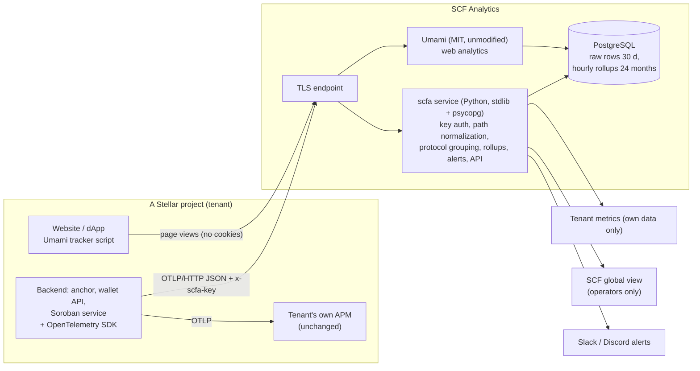

# SCF Analytics: Technical Architecture

**Shared, privacy-first web and API analytics for Stellar ecosystem projects.**
Built for the SCF RFP *"Web and API Analytics for Stellar Ecosystem Projects"*.
Repository: https://github.com/kuidsh/scf-analytics · Licence: Apache-2.0 · Status: prototype v0.1, not deployed

Status words used in this document: **Built** (code and a passing test), **Designed** (written down, not implemented), **Open** (not started). The source of truth for RFP coverage is [RFP-COVERAGE.md](RFP-COVERAGE.md). Money, tranches and the schedule live in [PROPOSAL.md](../PROPOSAL.md), not here.

---

## 1. What the platform does

SCF runs one multi-tenant service. Every Stellar project (anchor, wallet, dApp, Soroban service) gets:

* **API analytics** (Built): request volume, status classes, failed rate, p50/p95/p99 latency per normalized route, grouped by Stellar protocol (SEP-10, SEP-12, SEP-24, SEP-31, Soroban RPC, Horizon), an SLO with an error budget, Slack/Discord alerts and CSV export.
* **Web analytics** (Designed): page views, unique visitors, referrers, session duration, bounce rate, country, device and browser, from a self-hosted Umami. The client and summary code exist (`scfa/umami.py`, tested offline); it has **not** been run against a live Umami.
* A private per-project dashboard. The demo page shows the layout with made-up data; serving it per project from the API is Open (v0.2).

SCF operators get a **global view** with per-project totals only, plus enrollment control, key rotation and revocation, and project erasure (all Built).

## 2. Architecture

| Component | Technology | Role | Status |
|---|---|---|---|
| API ingest | `scfa/otlp.py`, OTLP/HTTP **JSON** | Keeps SERVER spans only, strips query strings, normalizes paths. Protobuf returns 415; bodies over 5 MB return 413 | Built |
| Metrics service | `scfa/app.py`, `metrics.py`, `rollup.py`, `alerts.py`; Python standard library + `psycopg` | Key auth, protocol grouping, percentiles, SLO, rollups, alerts, operator API. Runs as a local server, in Docker, or as AWS Lambda (SAM template) | Built (not deployed) |
| Storage | `scfa/store.py`: PostgreSQL, or SQLite for tests | Flat rows 30 days, hourly rollups 730 days, purged by the 5-minute job | Built; verified on Postgres via Docker |
| Web analytics | Umami (MIT), self-hosted, unmodified | One website per tenant, aggregates in PostgreSQL | Designed; per-tenant provisioning is Open |
| Infrastructure | `infra/template.yaml` (SAM), `infra/docker-compose.yml` | Single-box stack for staging; redundant deployment is the production design | Designed |

There is no OpenTelemetry Collector in the current design: tenants send OTLP JSON straight to `scfa`, which already filters to the fields below. A Collector in front is an option if protobuf support is needed (Open).

## 3. Stellar-specific behaviour

### 3.1 Path normalization (Built, `test_path_normalization_hides_ids_and_addresses`)

Stellar paths are full of strkeys and hashes. Counting them raw would turn every account into its own route and store wallet addresses. `normalize_path` in `scfa/otlp.py` works per path segment:

| Segment looks like | Replaced with |
|---|---|
| Account `G…` or muxed `M…` strkey | `{account}` |
| Contract `C…` strkey | `{contract}` |
| Other strkey prefixes (`S`, `T`, `P`, `X`) | `{key}` |
| UUID | `{uuid}` |
| 32+ hex characters, optionally `0x` | `{hash}` |
| All digits | `{id}` |
| Long opaque token (24+ characters with letters and digits) | `{token}` |
| Query string | dropped |

Routes are capped at 200 characters. Result: usage is counted per endpoint and no Stellar address is stored.

### 3.2 Protocol grouping (Built, prefix-based)

`scfa/metrics.py` maps a route to a protocol by **path prefix**, first match wins: `/sep10` (SEP-10 auth), `/sep12` (SEP-12 KYC), `/sep24`, `/sep31`, `/rpc` (Soroban RPC), `/horizon`; anything else is "Other". This assumes the tenant mounts each service under those prefixes.

Designed, not built: reading the tenant's `stellar.toml` (SEP-1: `WEB_AUTH_ENDPOINT`, `TRANSFER_SERVER_SEP0024`, `KYC_SERVER`, `DIRECT_PAYMENT_SERVER`) to map endpoints by base URL instead of by prefix; SEP-6 and SEP-38 groups; using `stellar.toml` presence as an ecosystem signal for operator review.

### 3.3 Soroban RPC per-method breakdown (Open)

Soroban RPC is JSON-RPC: every call is `POST` to one path, so path metrics cannot tell `simulateTransaction` from `getEvents`. The plan is to keep the OpenTelemetry `rpc.method` attribute (one low-cardinality field) and group by it. Today `rpc.method` is **not** read; Soroban RPC is one line. This is a possible feature, not committed scope.

### 3.4 Stellar Wallets Kit events (Open)

An optional hook that wraps connect and sign calls and sends Umami custom events (wallet module name, sign success or error; never an address or XDR). It is the RFP's nice-to-have and is not committed scope.

## 4. API data path

1. The tenant adds a second OTLP exporter next to its own APM, protocol `http/json`, with header `x-scfa-key=<key>`.
2. `scfa` authenticates the batch by project key (stored as SHA-256 only, shown once).
3. Only SERVER spans (kind 2) are read. Kept fields: project, normalized route, method, status code, duration, time. Accepts new and pre-1.20 HTTP semantic-convention names. Trace ids, span ids, bodies and headers are not stored.
4. Each batch is written as raw rows (30 days) and upserted into hourly rollups with latency histograms (730 days).
5. Windows up to 720 h read raw rows (exact percentiles). Longer windows (up to 8760 h) read rollups; percentiles are then histogram bucket upper edges (5…10000 ms), shown as "≈". The response carries `source: "raw"` or `"rollup"`.
6. Alert rules (`error_rate`, `p95_ms`, `p99_ms`, `requests_min`) run every 5 minutes and post to a webhook (body has `text` and `content`, so Slack and Discord both work).

Load target: **1,000,000 requests per day**, from the RFP. The load test is Open.

## 5. Web data path (Designed)

1. The tenant pastes one script tag (pinned Umami version, integrity hash). Umami sets no cookies; the IP is used in memory for country and the daily visitor hash, then discarded.
2. Umami keeps aggregates in the shared PostgreSQL, one website per tenant.
3. `scfa/umami.py` reads stats and breakdowns through Umami's REST API and `web_summary()` returns every RFP web metric.

Open hardening work, described in [WEB-ANALYTICS.md](WEB-ANALYTICS.md): bot and inflation mitigation beyond Umami's filter, a tracker served under a neutral name for ad blockers, SBOM and signed releases. Umami's default login (admin / umami) must be changed on first login and the stack never exposed publicly with it.

## 6. Multi-tenancy and security (Built)

* Every query filters by `project_id` (`test_api_ingest_and_metrics_are_tenant_isolated`). The global view returns per-project totals only (`test_global_view_requires_admin`).
* Operators authenticate with the `x-scfa-admin` token (`ADMIN_TOKEN`).
* **Enrollment is closed by default.** `ENROLLMENT=invite` needs an `x-scfa-invite` code from `ENROLL_INVITES`; `ENROLLMENT=open` allows anyone; both are capped by `ENROLL_MAX_PER_HOUR` (default 10, then 429). Operators can always enroll (`test_enrollment_is_closed_by_default_and_gated`).
* Operators can rotate or revoke a key and delete a project, which erases its rows and rollups (`test_self_service_enrollment_and_operator_controls`). Erasing the matching Umami website is Open until provisioning exists.

## 7. Privacy and GDPR

* Stored: project, normalized route, method, status, latency, time, and web aggregates. **Never stored:** IPs, user agents, query strings, bodies, headers, trace or span ids, Stellar addresses.
* Region: AWS Frankfurt proposed; availability of the Lightsail HA database and load balancer there is **unconfirmed**.
* Consent: most jurisdictions need no opt-in for cookieless analytics. Germany (TDDDG §25) and other strict ePrivacy states may; tenants there load the tracker after consent. Counsel review is a planned item. Details: [PRIVACY-GDPR.md](PRIVACY-GDPR.md).

## 8. Availability, hosting and handover

The RFP targets 99.99% ingestion and 99.90% dashboard availability. These are **targets we measure and publish, not guarantees**.

* Design: two instances in different zones behind a load balancer, HA managed PostgreSQL, OTel exporters retry on failure, external uptime checks. About US$131 a month; the single-server tier (about US$59) is staging only. Prices and sources: [COSTS.md](../COSTS.md), [OPERATIONS.md](OPERATIONS.md).
* Vulnerabilities rated critical or high are patched within 24 hours; dependencies are minimal (`psycopg` only).
* The proposer hosts for 12 months, then hands over to a community operator (months 6-12): repository, infrastructure code, data export, domain, secrets rotated, one-week overlap.

## 9. Delivery stages

Mirrors [README.md](../README.md#delivery-stages); amounts are in PROPOSAL.md.

| Stage | Month | Technical result |
|---|---|---|
| T0 Foundation | 1 | Public repository, architecture, privacy and operations documents, staging environment, first tagged release |
| T1 MVP | 2.5 | Multi-tenant Umami, per-project dashboard served by the API, hardened tracker, backup and restore drill |
| T2 Pilots and scale | 4 | 3 web and 1 API pilot live, global view and alerts, onboarding guides (JS, Go, Rust, Python), load test at 1,000,000 requests a day |
| T3 Launch | 5 | Production with TLS and redundant ingestion, failover test and measured availability report, runbook, tested handover |

## 10. What exists today

Built and covered by 18 offline tests: OTLP JSON ingest, path normalization, tenant isolation with hashed keys, raw rows plus 24-month hourly rollups, percentiles, protocol groups, SLO, alerts, enrollment gate, key rotation and revocation, project erasure, CSV export, time ranges from 1 h to 1 y, a SAM template and a Docker Compose stack (the Docker stack was run locally against Postgres; nothing is deployed to AWS). No CI workflow is claimed here. Not yet done: live Umami run, web hardening, load test, redundant hosting, runbook, onboarding guide, pilots.
